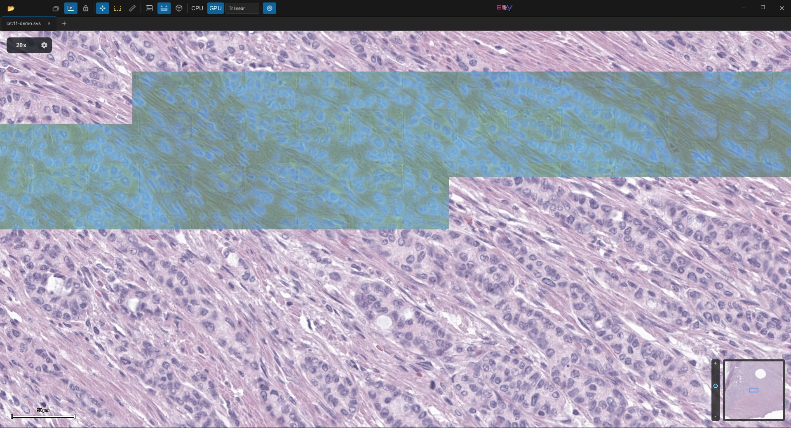
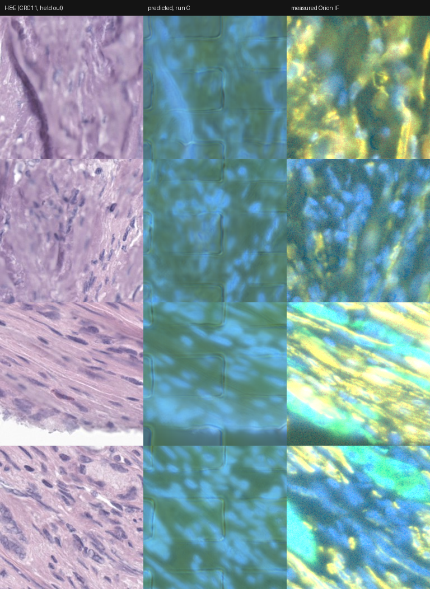

# Cellaris marker overlay for eov

> **Research use only. Not for diagnosis.** The overlay shows what a model *predicts* the Orion
> multiplex-immunofluorescence channels would look like on an H&E slide. It is not a
> measurement, it has not been validated for any clinical purpose, and eov is not a medical
> device. Every view of a prediction says so.

A plugin for [eov](https://github.com/eosin-platform/eov) based on the Cellaris model, a histology
project that asks which of the 19 Orion multiplex-IF channels are predictable from an H&E
whole-slide image.

Marker heads have been trained on 15 and on 41 patients. What they learn beyond a tissue-density
control is small, uneven across markers, and bounded by something we can now measure.

Every number is scored against a tissue-density control: a predictor that knows nothing but optical
density. It reaches 0.71 AUC on an unstained channel, so a raw AUC near 0.75 can mean nothing was
learned. Read the gain over the control, never the AUC itself.

## The plugin

It reads tiles under the viewport through eov, predicts them on a worker thread, and paints three
markers over the H&E: Hoechst in yellow, Pan-CK in magenta and SMA in bluish green. Those are the
three that clear the control on the Orion cohort. CD8a was in the first version and came out again,
because it does not.

The colours stay distinct for protanopia, deuteranopia and tritanopia (ΔE ≥ 60 between each pair
under simulation; a test keeps it that way) and stand out against both haematoxylin and eosin. The
first version's green Pan-CK and amber SMA were a red-green confusion pair.

(The screenshot is of the first version, with its old colours.)

## What it inherits from the measurements

The model was trained on 256 px inputs at the Orion scanner's 0.325 µm/px and does not generalise
past them: a 384 px input puts a ring of +2 arcsinh around every tile. So inference runs on 256 px
windows *at the model's own pixel size* — 83 µm of tissue, whatever the slide was scanned at — with
a half-window stride and feathered blending, which measures 0.91 at the joins against 4.88
unblended and 22.7 for a 384 px window. Past 600 cells in a view it declines, and says "zoom in",
rather than predicting at a scale the model never saw.

One window takes about 1.2 seconds on a CPU, so a view at 1:1 fills in over a few minutes. There is
no GPU path yet. What has been computed is kept on disk, so a slide opened again comes back at once.

## What it actually shows

On its own the overlay looks convincing. Next to the measured IF on a patient the model never saw,
it is a nuclear stain with a tint.

Pixel correlation between predicted and measured on those four tiles runs +0.19 to +0.91 for
Hoechst, -0.07 to +0.21 for Pan-CK and -0.10 to +0.32 for SMA. Hoechst is the part haematoxylin
gives away, since haematoxylin and Hoechst both bind nucleic acid. Pan-CK comes out as a wash where
the measurement is patchy, and SMA is missing from stroma that measures full of it.

The model, and how good it is, live in cellaris.

## Region readout

The region tool outlines a polygon; the panel can also measure eov's region of interest. For each
marker the panel gives three numbers: its mean predicted intensity over the tissue inside, its
spread, how much it varies between blocks, and density r², how much of that variation optical
density alone reproduces there.

The control is the same one cellaris scores against, the mean optical density of the H&E. With no
segmentation in the viewer it is measured over blocks of 16 model pixels — 5.2 µm, about a cell, on
every scanner — rather than cells, and blocks under 0.04 optical density are left out as glass. That
is the gap between glass and tissue on CRC11. The first version borrowed the 0.15 tile cutoff from
cellaris, which threw out 73% of the tissue blocks and, with them, the pale end of the density
range, so it read density r² low. Blocks not wholly on the slide, and blocks with near-black pixels
(ink, debris, a fluorescence image), are left out too and counted.

Near 1 the marker is a density map in that region, whatever it is called. A low value is needed for
it to be anything more, but it is not enough. A prediction that barely changes scores low too,
because there is nothing for density to explain, and that is what the spread is there to show. Only
measured IF can say a marker is the marker.

The numbers come from the same feathered predictions the overlay paints, so there are no window
joins in them and they match what is on screen. The first version measured non-overlapping 256 px
windows, where about a quarter of the blocks sit at a window edge; the join variance inflated the
spread and pulled r² down. Regions are re-measured when the outline is edited, large regions ask
before they start, a running readout can be cancelled, and Copy puts the numbers on the clipboard as
tab-separated text with their provenance: slide, model SHA-256, pixel sizes, windows, area and
date.

Two regions on CRC11, measured by the first version (unblended 256 px windows, blocks of 16 slide
pixels) and not yet measured again with this one:

| Region | Tissue | Hoechst mean / spread / r² | Pan-CK | SMA |
|---|---|---|---|---|
| Tumour | 0.980 mm², 36,258 blocks | 6.75 / — / 0.72 | 4.67 / — / 0.24 | 4.39 / — / 0.01 |
| Vessel wall and stroma | 0.024 mm², 893 blocks | 6.57 / 0.58 / 0.58 | 4.60 / 0.04 / 0.41 | 4.37 / 0.05 / 0.00 |

The tumour region was read before the spread column existed.

Hoechst varies and is mostly density, which is what the pixel comparison above said. Pan-CK and SMA
barely vary at all, a spread of 0.04 and 0.05 against Hoechst's 0.58, so their low r² means nothing.
SMA sits at 4.37 to 4.39 in every region tried, near the floor of its display window, including
round what looks like a vessel wall, where measured SMA would be bright. That is my reading of the
H&E, not a measurement, but it matches the missing stroma in the comparison above.

Under 30 tissue blocks there is no r².

## Installing

You need eov 1.0 or newer, ONNX Runtime 1.17 or newer, and a marker model.

**The plugin.** Install a release package with `eov plugin install cellaris`, or a downloaded one
with `eov plugin install ./cellaris-v1.0.0-<platform>.eop`. Release packages for Linux, Windows and
Apple-silicon macOS bundle ONNX Runtime; on Intel macOS install it with `brew install onnxruntime`.

**The model** (`markers.onnx`, exported by cellaris) is not shipped. Put it in the plugin's data
directory, or choose it in the Cellaris panel (*Choose model…*):

| Platform | Data directory |
|---|---|
| Linux | `~/.local/share/eov/plugins/cellaris/` |
| macOS | `~/Library/Application Support/eov/plugins/cellaris/` |
| Windows | `%LOCALAPPDATA%\eov\plugins\cellaris\` |

(`$EOV_DATA_DIR/plugins/cellaris/` when eov's data directory is redirected; the panel shows the
path it looks in.) Version 0.1 looked in `~/.eov/plugins/cellaris/`; move the model from there.

**ONNX Runtime**, when the package does not bundle it, is looked for in this order:

1. `CELLARIS_ORT_DYLIB`, the runtime chosen in the panel (*Choose runtime…*), or `ORT_DYLIB_PATH`
   — a library file, or a directory holding one (an extracted ONNX Runtime release works as is).
   If one of these is set and wrong, that is reported; nothing else is tried.
2. The plugin package, then the data directory above.
3. The system: the dynamic loader's search path (`libonnxruntime.so` / `libonnxruntime.so.1` on
   Linux, `onnxruntime.dll` on Windows), plus `/opt/homebrew/lib` and `/usr/local/lib` on macOS and
   `/usr/local/lib` on Linux.

On Linux, the `onnxruntime-linux-x64` release from Microsoft, a distribution package, or the
library inside a pip `onnxruntime` wheel (`site-packages/onnxruntime/capi`) all work. On Windows use
`onnxruntime.dll` from `onnxruntime-win-x64`; Windows' own copy in `System32` is often too old, and
if it is the one found, the panel says so. A runtime older than 1.17 is reported with its version
and path. ONNX Runtime loads once per process: choosing another one takes effect after a restart.

`CELLARIS_MODEL` overrides the model path the same way.

## Using it

The toolbar gets three things:

- **Cellaris: predicted markers** turns the overlay on and off for every open slide. The model
  loads the first time something needs it; if that fails, the panel says why, and turning the
  overlay on again, *Retry* or choosing another model tries again, without restarting eov.
- **Cellaris panel** shows the legend, the per-marker toggles, opacity, a fluorescence-style mode
  (colour on black over all tissue), the region readout and the model card.
- **Cellaris region readout**, a polygon tool.

On the slide, each pane carries a badge — *PREDICTED — research use only, not for diagnosis* — with
progress and warnings under it, and a legend of the markers shown. Areas still being computed are
veiled; areas that failed are outlined in red and retried, backing off, up to five times. Glass,
areas without image data and near-black areas are never painted. Split views compute each pane's
view; work starts at the centre of each view and the panes take turns.

Slides that do not report their pixel size are not computed unless *Assume the model's pixel size*
is on, and then the badge says the scale is assumed. Slides coarser than the model are upsampled
and flagged as less reliable; more than twice as coarse (1 µm/px for this model) is refused. A slide
whose metadata names a stain other than H&E is flagged.

Settings are kept by eov, in `settings.json` in the data directory above. A few have no control in
the panel yet and can be set there while eov is closed: `markers` (the channels to predict, up to
six of the model's, default `["Hoechst", "Pan-CK", "SMA"]`; past three, colours are harder to tell
apart, so hide some), `batch_size` (windows per run, default 4), `threads` (inference threads,
default half the CPUs, at most 8) and `disk_cache_mb` (default 2048; 0 turns the disk cache off).

## The model's metadata

Any export from cellaris works. Markers are resolved by name against the channel order recorded in
the model file, and a model that carries no channel order is refused rather than guessed at. An
earlier version hard-coded the indices and painted Ki67 as Pan-CK. The plugin reads:

| Key | | |
|---|---|---|
| `channel_names` | required | comma-separated, or a JSON list |
| `raw_intensity` | `true`/`false` | whether outputs are raw intensities (shown as arcsinh(x/5)); assumed `true` if absent |
| `mpp` | µm/px | the training pixel size; 0.325 is assumed if absent, and the model card says so |
| `tile_size` | px | window side for graphs with a dynamic input size; default 256 |
| `recon_error_threshold` | | flags windows whose reconstruction error is above it as unlike the training data |
| `name`, `version`, `description`, `training_data`, `license` | | shown in the model card |

The input is `[batch, 3, H, W]` in [-1, 1]; outputs are `markers [batch, C, H, W]` and optionally
`recon_error [batch, 1, H, W]`. Shapes are checked on every run. Exporting with `mpp` recorded is
strongly recommended.

## Building

The plugin is its own Cargo workspace and builds inside an eov checkout, where the submodule lives
(`plugins/cellaris`); `eov-plugin-api` 1.0 comes from that checkout until it is on crates.io.

    cargo build --release --manifest-path plugins/cellaris/Cargo.toml

From the plugin directory:

    cargo test                                   # unit and mock-host tests, no ONNX Runtime needed
    CELLARIS_SMOKE_ORT=/path/to/onnxruntime \
        cargo test --release ort_smoke -- --ignored   # against a real runtime
    cargo run --manifest-path tools/check/Cargo.toml --features ui --bin ui
    cargo run --manifest-path tools/check/Cargo.toml --bin load -- target/release/libcellaris.so

The runtime tests use `tests/data/markers-synthetic.onnx`, a model with the real interface that
predicts nothing (`tools/make_test_model.py` writes it). `ui` compiles the panel with eov's Slint
interpreter and checks every property the plugin sends it; `load` opens the built library the way
eov does, with its layout checks, and drives it through a mock host.

Packaging:

    python3 package.py                                   # cellaris.eop
    python3 tools/fetch_onnxruntime.py --platform linux-x86_64 --dest /tmp/ort
    python3 package.py --onnxruntime /tmp/ort/onnxruntime-linux-x64-1.30.0
    python3 package.py --model markers.onnx              # bundle a model, prints its SHA-256

`fetch_onnxruntime.py` downloads a pinned ONNX Runtime and checks its SHA-256. `package.py` only
bundles ONNX Runtime together with its licence and third-party notices, and writes the package's
SHA-256 beside it. CI builds, tests and packages on Linux, macOS and Windows, x86_64 and arm64; the
*Release* workflow publishes the packages with a `release.toml` that `eov plugin install` reads.

## Intended use, safety and privacy

- Research and education only. Not for primary diagnosis or any clinical decision.
- Predictions are not measurements. The display windows are fixed from one cohort (Orion CRC,
  1st–99.5th percentile of measured IF), so values outside it saturate.
- Nothing detects every input the model was not trained on. The plugin flags what it can: an
  unknown, assumed or mismatched pixel size, a stain other than H&E in the slide's metadata,
  near-black areas, and windows above the model's reconstruction-error threshold when the model
  records one. Frozen sections, IHC, other stains, scanners and tissues may give confident,
  wrong-looking or right-looking predictions alike.
- Nothing leaves the computer. ONNX Runtime's telemetry is turned off. A copied readout names the
  slide by its file name, never its path (file names can still identify a patient; check before
  sharing), and cached cells are keyed by the slide's content identity from eov, not its path.

## Licensing and provenance

The plugin is MIT, Apache-2.0 or GPL-3.0, the same three eov offers, at your option; the texts are
in the package under `licenses/cellaris/`.

ONNX Runtime is MIT-licensed by Microsoft. Packages that bundle it include its `LICENSE` and
`ThirdPartyNotices.txt` under `licenses/onnxruntime/`.

The model is not distributed with the plugin. The model card shows the model file's SHA-256, and
every copied readout carries it; record it with any result. The Orion CRC data the model was trained
on are subject to the terms published with that dataset; check them, and the model's own licence,
before redistributing a model or a package that contains one.

## References

The data the model was trained on, and the two conventions the overlay borrows. The rest — the
controls, the ceiling, the patient bootstrap, the cross-cohort work — are in cellaris.

Lin J-R, Chen Y-A, Campton D, Cooper J, Coy S, Yapp C, Tefft JB, McCarty E, Ligon KL, Rodig SJ,
Reese S, George T, Santagata S, Sorger PK. High-plex immunofluorescence imaging and traditional
histology of the same tissue section for discovering image-based biomarkers. Nature Cancer (2023).
doi:10.1038/s43018-023-00576-1 — the Orion CRC cohort.

Ronneberger O, Fischer P, Brox T. U-Net: convolutional networks for biomedical image segmentation.
MICCAI (2015). arXiv:1505.04597 — the marker head.

Kingma DP, Welling M. Auto-encoding variational Bayes. ICLR (2014). arXiv:1312.6114 — the shared
encoder.

Bendall SC, Simonds EF, et al. Single-cell mass cytometry of differential immune and drug responses
across a human hematopoietic continuum. Science 332, 687—696 (2011). doi:10.1126/science.1198704 —
the arcsinh transform with cofactor 5, used to display every intensity here.

Machado GM, Oliveira MM, Fernandes LAF. A physiologically-based model for simulation of color vision
deficiency. IEEE TVCG 15(6) (2009) — the simulation the palette is checked with.

Built on eov, which carries its own licence and history.
